<div align="center">

# Código em Cena

**O portfólio de Alexandre Junior encenado como uma peça de teatro de papel.**<br>
Cada capítulo da trajetória vira uma cena de um filme que avança com o scroll.

**[portfolio-alexandrejr.vercel.app](https://portfolio-alexandrejr.vercel.app)**


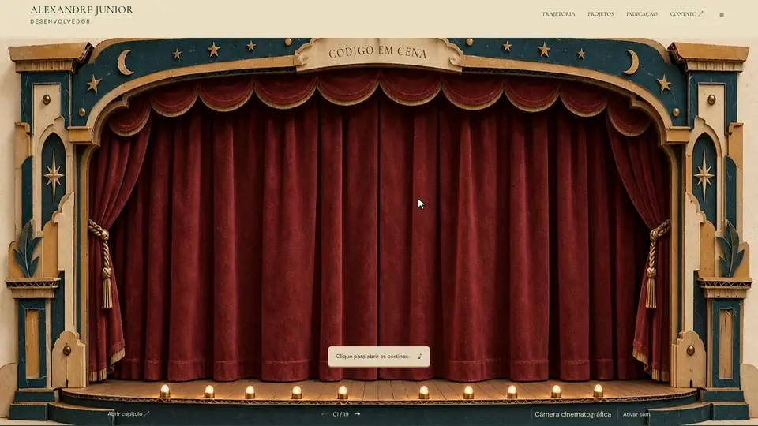

</div>

## Sumário

- [Visão geral](#visão-geral)
- [Prints](#prints)
- [Stack](#stack)
- [Arquitetura](#arquitetura)
  - [Fluxo de dados](#fluxo-de-dados)
  - [Ciclo de um quadro](#ciclo-de-um-quadro)
  - [Estrutura de pastas](#estrutura-de-pastas)
  - [Padrões e exemplos](#padrões-e-exemplos)
- [Acessibilidade](#acessibilidade)
- [Performance](#performance)
- [Mídia e conteúdo](#mídia-e-conteúdo)
- [Qualidade e testes](#qualidade-e-testes)
- [Como rodar](#como-rodar)
- [Scripts](#scripts)
- [Deploy](#deploy)
- [Licença](#licença)

## Visão geral

O site é um filme de 2 minutos (2.880 quadros a 24 fps) de um teatro de papel feito à mão. O scroll não troca de página: ele define até onde o filme deve ir, e o palco percorre esse trecho no ritmo natural da animação, para a frente ou para trás.

Tudo o que é texto fica fora do vídeo, em HTML: os cards de cada experiência, o título curvo na placa do proscênio, a navegação e o "programa da peça", com o currículo completo. Assim o conteúdo é selecionável, acessível e indexável, e muda sem precisar reeditar o filme.

- **19 capítulos em 4 atos**: trajetória, formação e projetos, sistemas e jogos, e uma carta de recomendação.
- **Scroll em tempo real**: 200 px de rolagem equivalem a 1 s de filme. Menu e setas percorrem as cenas a 1,5×.
- **Câmera cinematográfica 2D**: aproximações registradas por quadro-chave, com enquadramento `contain` no desktop e `cover` no celular.
- **Trilha sonora ligada por padrão**, liberada no primeiro clique, toque ou tecla, como exigem os navegadores.
- **Versão sem animação** para impressão e leitores de tela, gerada do mesmo JSON do currículo.

## Prints

<table>
  <tr>
    <td width="50%">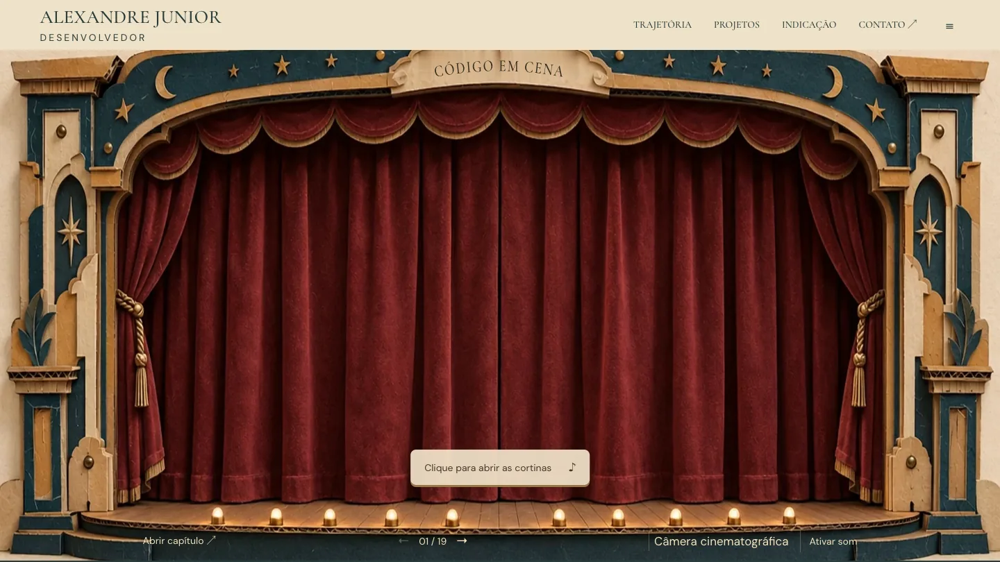</td>
    <td width="50%">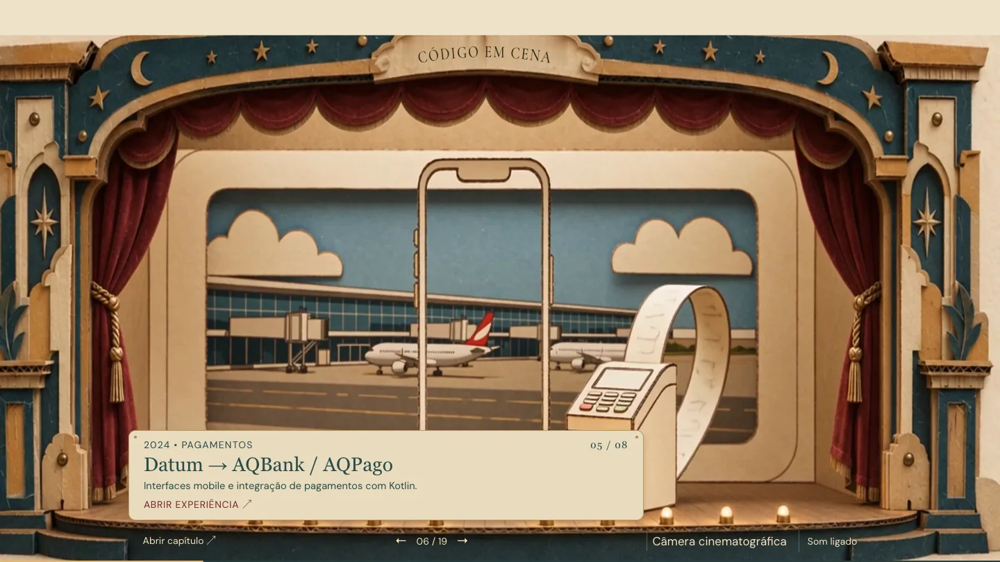</td>
  </tr>
  <tr>
    <td align="center"><sub>Abertura: a cortina espera o primeiro clique</sub></td>
    <td align="center"><sub>Datum → AQBank / AQPago, com o card da experiência</sub></td>
  </tr>
  <tr>
    <td>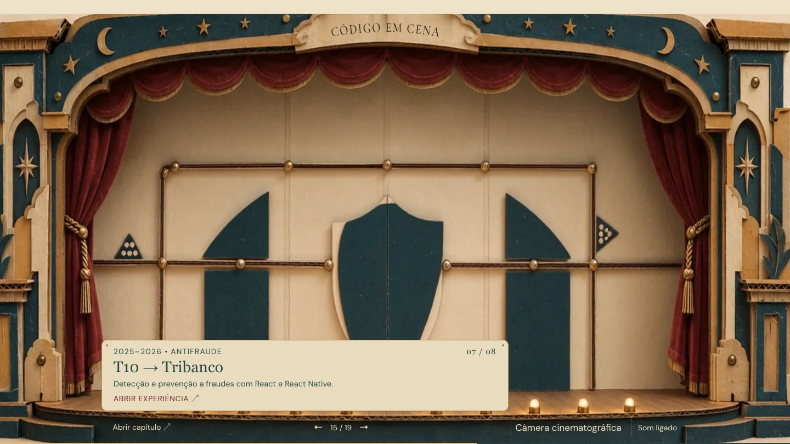</td>
    <td>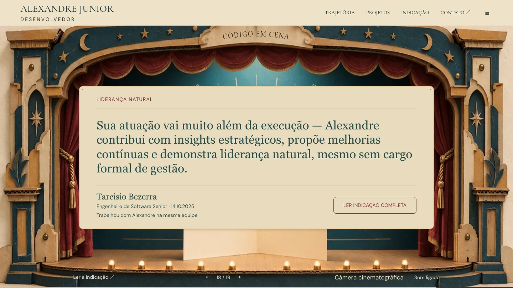</td>
  </tr>
  <tr>
    <td align="center"><sub>T10 → Tribanco: detecção e prevenção a fraudes</sub></td>
    <td align="center"><sub>A carta de recomendação, em citações sincronizadas com o filme</sub></td>
  </tr>
  <tr>
    <td colspan="2">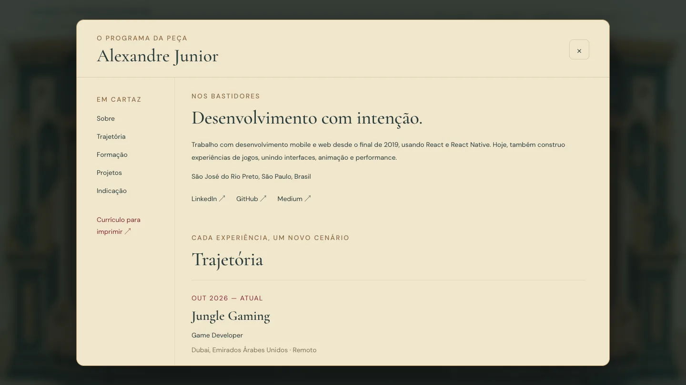</td>
  </tr>
  <tr>
    <td colspan="2" align="center"><sub>O "programa da peça": currículo completo num <code>&lt;dialog&gt;</code> acessível</sub></td>
  </tr>
</table>

<table>
  <tr>
    <td align="center">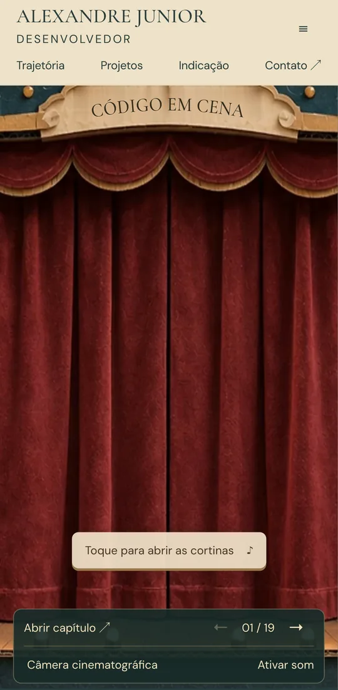</td>
    <td align="center">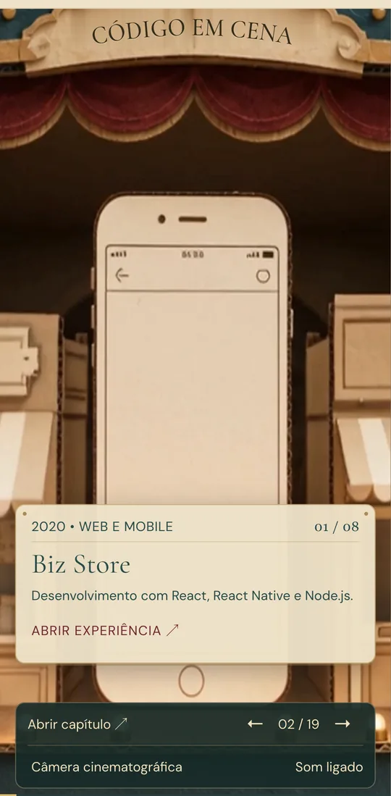</td>
    <td align="center">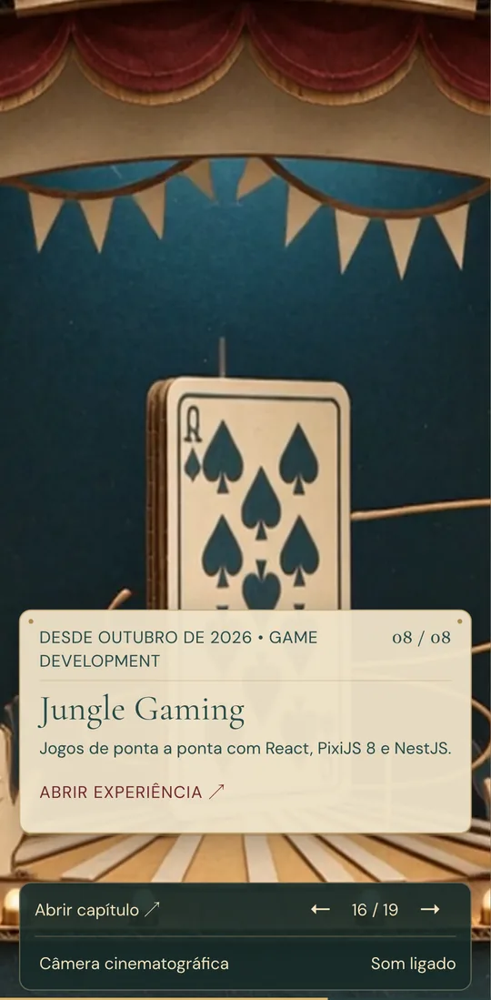</td>
  </tr>
  <tr>
    <td align="center"><sub>No celular, o convite vira "Toque"</sub></td>
    <td align="center"><sub>Enquadramento <code>cover</code> em retrato</sub></td>
    <td align="center"><sub>Jungle Gaming, o capítulo atual</sub></td>
  </tr>
</table>

## Stack

| Camada                | Tecnologia                                               | Papel no projeto                                                                                                |
| --------------------- | -------------------------------------------------------- | --------------------------------------------------------------------------------------------------------------- |
| Interface             | React 19 · TypeScript 5.9                                | Componentes, estado da interface e tipagem estrita (`strict`, `verbatimModuleSyntax`, `erasableSyntaxOnly`)     |
| Build                 | Vite 7                                                   | Servidor de desenvolvimento, build de produção e chunk sob demanda para o palco                                 |
| Filme                 | PixiJS 8 (WebGL)                                         | Vídeo como textura, câmera 2D e renderização apenas enquanto o filme se move                                    |
| Animação da interface | Framer Motion                                            | Entrada e saída dos cards e posicionamento por `MotionValue`, fora do ciclo de render do React                  |
| Estilo                | Tailwind CSS 4 · CSS                                     | Utilitários e `@apply` na composição mobile, tokens de cor e de raio em `:root`, sem o reset global (preflight) |
| Tipografia            | Fontsource                                               | Cormorant Garamond e DM Sans servidas pelo próprio site, só no subconjunto latino                               |
| Testes                | node:test · tsx · Playwright · axe-core                  | Lógica pura, ponta a ponta em três tamanhos de tela e auditoria WCAG 2.1 AA                                     |
| Qualidade             | ESLint 9 · typescript-eslint · Prettier                  | Regras do React Compiler (`eslint-plugin-react-hooks` 7) e formatação única                                     |
| Mídia                 | ffmpeg · ffprobe · sharp · Apple Vision · glTF-Transform | Edição e limpeza do filme, imagens WebP e modelos do estudo 3D                                                  |
| Entrega               | Git LFS · Vercel                                         | Filme versionado fora do Git comum e deploy contínuo a partir da `main`                                         |

> [!NOTE]
> `src/scene/` guarda um estudo anterior do palco em React Three Fiber (`three`, `@react-three/fiber`, `@react-three/drei`), com modelos GLB gerados por `scripts/build-assets.mjs`. Ele não é carregado na experiência atual, que usa o filme.

## Arquitetura

A aplicação separa três responsabilidades:

1. **O palco** (`src/pixi/FilmStage.tsx`, PixiJS) desenha o filme e decide o quadro exibido.
2. **Stores pequenas**, fora do React, carregam o tempo do filme, o capítulo, o card e o enquadramento de cada quadro.
3. **A interface** (React) assina apenas o que lhe interessa e só renderiza quando esse valor muda.

### Fluxo de dados

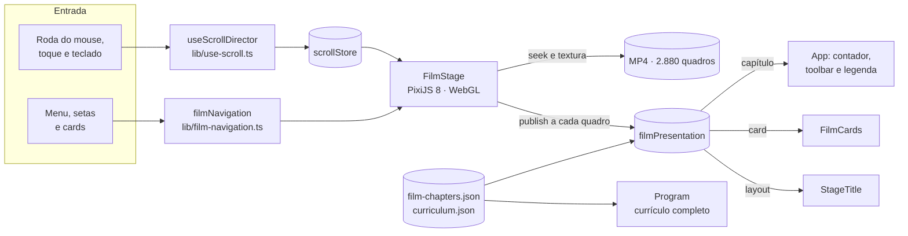

### Ciclo de um quadro

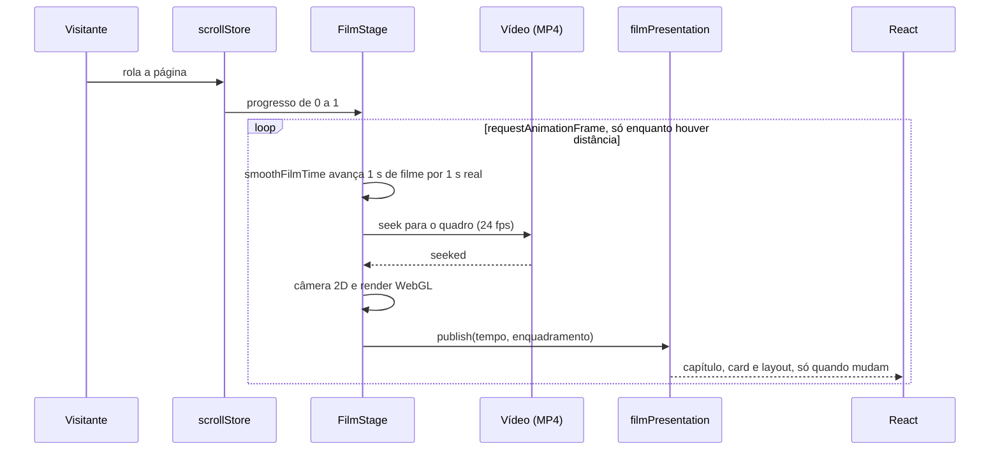

### Estrutura de pastas

```text
src/
├── main.tsx                  # entrada: fontes, estilos e <App />
├── App.tsx                   # composição da página, toolbar e estados de carregamento
├── pixi/
│   └── FilmStage.tsx         # palco PixiJS: vídeo como textura, câmera e loop de quadros (lazy)
├── components/
│   ├── FilmCards.tsx         # cards sincronizados com o filme (Framer Motion)
│   ├── StageTitle.tsx        # título SVG curvo que acompanha a placa filmada
│   ├── Program.tsx           # "programa da peça": currículo completo em <dialog>
│   └── FilmBoundary.tsx      # error boundary do palco
├── lib/
│   ├── film-camera.ts        # tempo do filme, câmera 2D, contain e cover
│   ├── film-presentation.ts  # store do quadro publicado: capítulo, card e layout
│   ├── film-navigation.ts    # canal tipado entre menus, botões e o palco
│   ├── film-loader.ts        # primeiro quadro decodificado, ativação no iOS, prazo e cancelamento
│   ├── scroll-store.ts       # progresso do scroll
│   ├── timeline.ts           # capítulos derivados dos dados e navegação por capítulo
│   ├── use-scroll.ts         # hooks de scroll e de movimento reduzido
│   ├── use-soundtrack.ts     # trilha ligada por padrão, liberada no primeiro gesto
│   └── stage-title.ts        # interpolação do movimento da placa
├── data/
│   ├── curriculum.json       # experiências, formação, projetos e indicação
│   ├── film-chapters.json    # 19 capítulos: tempo, seção do programa e textos
│   ├── stage-title.json      # trilha de movimento da placa
│   └── portfolio.ts          # acesso tipado ao currículo
├── scene/                    # estudo 3D em React Three Fiber (fora da experiência ativa)
├── tailwind.css              # Tailwind 4 sem preflight
└── film.css · styles*.css    # palco, composição mobile e programa
e2e/                          # Playwright: smoke, navegação, layout e som
tests/                        # node:test: filme, capítulos e carregador
scripts/                      # pipeline de conteúdo e de mídia
public/
├── assets/film/              # filme (Git LFS) e poster WebP
└── content/                  # currículo em HTML estático e texto da indicação
docs/readme/                  # imagens deste README
```

### Padrões e exemplos

#### 1. Stores externas com `useSyncExternalStore`

O palco publica um quadro por vez. A store separa três canais: o **layout** muda a cada quadro, o **card** e o **capítulo** só quando trocam. Cada componente assina o canal de que precisa, então o React não re-renderiza 60 vezes por segundo.

```ts
// src/lib/film-presentation.ts (trecho)
publish(value: FilmPresentation) {
  frame = value;
  const index = chapters.findIndex(
    (chapter) => value.time >= chapter.start && value.time < chapter.end,
  );
  // ...
  if (index >= 0 && index !== chapterIndex) {
    chapterIndex = index;
    chapterListeners.forEach((listener) => listener());
  }
  if (visibleKey !== key) {
    key = visibleKey;
    cardListeners.forEach((listener) => listener());
  }
  layoutListeners.forEach((listener) => listener());
},
```

```ts
// src/lib/use-scroll.ts
const index = useSyncExternalStore(
  filmPresentation.subscribeChapter,
  filmPresentation.getChapterIndex,
  () => 0,
);
```

#### 2. Movimento por quadro fora do render

Os cards acompanham a câmera do filme a cada quadro. A posição é escrita em `MotionValue`s dentro da assinatura de layout, sem passar pelo estado do React. Um `ResizeObserver` recalcula quando o conteúdo do card muda de altura.

```tsx
// src/components/FilmCards.tsx (trecho)
useEffect(() => {
  function update() {
    const frame = filmPresentation.getFrame();
    const mode = layoutMode(frame);
    const layout = layouts[mode](frame, quote ? slots.letter : slots.chapter);
    // ...
    left.set(layout.left);
    top.set(mode === "stage" ? Math.max(TOOLBAR_GAP, Math.min(layout.top, floor)) : layout.top);
  }
  update();
  const resize = new ResizeObserver(update);
  if (anchor.current) resize.observe(anchor.current);
  const unsubscribe = filmPresentation.subscribeLayout(update);
  return () => {
    unsubscribe();
    resize.disconnect();
  };
}, [left, top, width, fontScale, quote, toolbar]);
```

#### 3. Dados como fonte de verdade e tabelas de lookup

Cada capítulo declara o próprio tempo no filme e a seção do programa que abre. Os componentes leem esse dado, sem cadeias de condicionais espalhadas pelo código. Onde há decisão, ela fica numa tabela tipada.

```json
{
  "id": "bizstore",
  "start": 4,
  "end": 7,
  "section": "bizstore",
  "period": "2020 • WEB E MOBILE",
  "title": "Biz Store",
  "description": "Desenvolvimento com React, React Native e Node.js.",
  "number": "01 / 08",
  "action": "ABRIR EXPERIÊNCIA"
}
```

```ts
// src/components/FilmCards.tsx
const layouts: Record<LayoutMode, (frame: FilmPresentation, slot: Slot) => Layout> = {
  mobile: (frame) => ({ left: 16, top: frame.height - 140, width: frame.width - 32, fontScale: 1 }),
  landscape: (frame) => ({ left: frame.width - 320, top: 16, width: 300, fontScale: 1 }),
  stage: (frame, slot) => ({
    left: frame.x + slot.x * frame.scale,
    top: frame.y + (slot.y - FILM.cropTop) * frame.scale,
    width: slot.width * frame.scale,
    fontScale: clamp(frame.scale, 1, 1.65),
  }),
};
```

```ts
// src/lib/timeline.ts
const actByStart = [
  { from: 86, act: 4 },
  { from: 57, act: 3 },
  { from: 27, act: 2 },
  { from: 0, act: 1 },
];
```

`tests/chapters.test.mjs` garante o contrato: capítulos contíguos de 0 a 120 s, toda seção existente no programa e atos em ordem.

#### 4. Navegação tipada entre a interface e o palco

Menus e botões não conhecem o renderizador. O palco se registra num canal pequeno e tipado, no lugar de eventos globais com nomes em texto.

```ts
// src/lib/film-navigation.ts
export type NavigationRequest = { progress: number; reducedMotion: boolean; label: string };
type Stage = { navigate: (request: NavigationRequest) => void; stop: () => void };

let stage: Stage | null = null;

export const filmNavigation = {
  attach(next: Stage) {
    stage = next;
    return () => {
      if (stage === next) stage = null;
    };
  },
  navigate(request: NavigationRequest) {
    stage?.navigate(request);
  },
  stop() {
    stage?.stop();
  },
};
```

#### 5. Tempo do filme independente da taxa de quadros

Um segundo de animação sempre leva um segundo de relógio, em telas de 24 a 120 Hz. A navegação por menu usa 1,5×, e o movimento reduzido salta direto ao destino. O loop de `requestAnimationFrame` termina quando o filme alcança o alvo: parado, o palco não desenha nada.

```ts
// src/lib/film-camera.ts
export function smoothFilmTime(
  current: number,
  desired: number,
  delta: number,
  reduced = false,
  playbackRate = 1,
) {
  if (reduced || Math.abs(desired - current) < 1 / 96) return desired;

  // A second of animation takes a second of wall time, like normal MP4 playback.
  const distance = desired - current;
  const step = Math.min(Math.abs(distance), Math.max(0, Math.min(delta, 0.1)) * playbackRate);

  return current + Math.sign(distance) * step;
}
```

#### 6. Câmera 2D com `contain` e `cover`

A câmera é uma transformação 2D do quadro. Quadros-chave de profundidade (`z`) e de foco (`x`, `y`) são interpolados com `smoothstep`. No desktop o filme cabe inteiro na tela; no celular, em retrato, ele a preenche.

```ts
// src/lib/film-camera.ts (trecho)
const fit = contentMode === "cover" ? Math.max : Math.min;
const base = fit(width / FILM.width, height / sourceHeight);
const key = cameraAt(time, automatic);
const scale = base * zoom * (1000 / (1000 - key.z));
```

#### 7. Carregamento resiliente

- **Carregador do filme** (`film-loader.ts`): espera só o primeiro quadro decodificado. Tenta reprodução muda e inline para ativar o decoder no iOS, mostra "Toque para iniciar o filme" se o navegador exigir um gesto e desiste após 30 s, com cancelamento por `AbortController`.
- **Error boundary e nova tentativa**: falhas no download do chunk ou no render do palco caem num fallback com "Tentar novamente", "Abrir o vídeo" e "Ler o currículo".

```tsx
// src/App.tsx (trecho)
<FilmBoundary key={attempt} onFailure={handleFailure}>
  <Suspense fallback={null}>
    <FilmStage
      key={attempt}
      onReady={handleReady}
      onFailure={handleFailure}
      onInteractionRequired={setInteractionRequired}
      // ...
    />
  </Suspense>
</FilmBoundary>
```

#### 8. Trilha sonora sob a política de autoplay

Navegadores só tocam áudio depois de um clique, toque ou tecla; rolar a página não conta. `use-soundtrack.ts` tenta tocar ao abrir e, se for bloqueado, começa no primeiro gesto. O convite de abertura ("Clique para abrir as cortinas ♪", ou "Toque" em telas de toque) é justamente esse gesto. Desligar pelo botão fica salvo para a próxima visita.

## Acessibilidade

- **Diálogo nativo**: o programa usa `<dialog>` com `showModal()`, que prende o foco, fecha com Esc e é rotulado pelo próprio título.
- **Hierarquia de títulos**: um único `<h1>`, visualmente oculto, e títulos em ordem.
- **Rótulo no nome (WCAG 2.5.3)**: o nome acessível de cada controle contém o texto visível.
- **Link de pular**: leva ao currículo em HTML estático (`public/content/curriculo.html`), gerado do mesmo JSON.
- **`prefers-reduced-motion`**: navegação direta, sem câmera automática nem animação dos cards.
- **Toque**: alvos de 44 px no celular.
- **Auditoria automática**: axe-core (WCAG 2.1 A/AA) roda nos testes e2e, nos três tamanhos de tela.

## Performance

- **Carga inicial**: o JavaScript da primeira tela soma cerca de 125 KB gzip (React e aplicação). O palco, com o PixiJS, chega depois num chunk próprio.
- **Renderização sob demanda**: só enquanto o filme se move, com o canvas limitado a 2× de densidade de pixels.
- **DOM por quadro**: escritas só quando o valor muda; cards e título se movem por `MotionValue`.
- **Vídeo para scrub**: H.264 com um keyframe a cada 6 quadros, para o seek responder rápido.
- **Primeira imagem**: o poster de abertura é um WebP de 173 KB com `preload`, e as fontes carregam só o subconjunto latino.

## Mídia e conteúdo

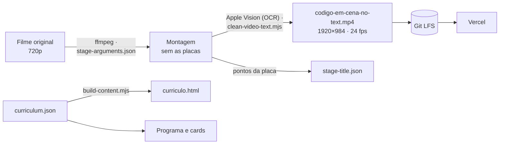

- **Montagem**: `work/clean-film/stage-arguments.json` registra os clipes e filtros que tiram as placas de texto do filme original.
- **Limpeza de inscrições**: `work/text-audit/scan.swift` encontra inscrições com o Apple Vision. `scripts/clean-video-text.mjs` as remove por interpolação local da textura e gera os pontos de acompanhamento da placa. O MP4 original fornecido pelo autor não é alterado.
- **Filme publicado**: 1920 × 984 a partir do original de 720p, sem a faixa do cabeçalho; não acrescenta detalhe nativo. É o único arquivo de vídeo no Git LFS.
- **Currículo**: `src/data/curriculum.json` alimenta o programa, os cards e, via `scripts/build-content.mjs`, a versão HTML para impressão.
- **Outros scripts**: `scripts/extract-film-assets.mjs` recorta 46 camadas do filme, e `scripts/build-assets.mjs` gera os modelos GLB, as texturas e os sprites do estudo 3D.

## Qualidade e testes

| Suíte              | Ferramenta                     | O que cobre                                                                                                                                                                                                                                            |
| ------------------ | ------------------------------ | ------------------------------------------------------------------------------------------------------------------------------------------------------------------------------------------------------------------------------------------------------ |
| Unitários (18)     | `node:test` + `tsx`            | Tempo do filme a 1× e 1,5× em qualquer taxa de quadros, câmera `contain`/`cover`, capítulos contíguos e seções existentes, aviso de capítulo, citações da carta, movimento da placa, carregador (iOS, cache, prazo, cancelamento) e integridade do MP4 |
| Ponta a ponta (63) | Playwright                     | 21 cenários em desktop (1440 × 900), laptop (1024 × 768) e Pixel 7: vídeo real em vez do ponteiro LFS, fallbacks, scroll, menu, setas, programa, layout e som                                                                                          |
| Acessibilidade     | axe-core                       | WCAG 2.1 A/AA, sem violações sérias ou críticas                                                                                                                                                                                                        |
| Estática           | TypeScript · ESLint · Prettier | Tipos estritos, regras do React Compiler e formatação                                                                                                                                                                                                  |

```bash
npm run lint
npm run format:check
npm test
npm run test:e2e
```

`npm run test:e2e` gera o build de produção, serve com `vite preview` e usa o Google Chrome instalado, que decodifica o H.264 do filme (o Chromium que vem com o Playwright não decodifica). `npm run test:e2e:prod` roda a mesma suíte contra o site publicado.

## Como rodar

**Requisitos:** Node.js 20.19+ ou 22.12+, [Git LFS](https://git-lfs.com) para baixar o filme, Google Chrome para os testes e2e e `ffmpeg`/`ffprobe` para o teste de mídia e os scripts.

```bash
git lfs install
git clone https://github.com/ItsJuniorDias/portfolio-alexandrejr.git
cd portfolio-alexandrejr
npm install
npm run dev
```

Abra http://127.0.0.1:5173. Sem o Git LFS, o arquivo do filme chega como um ponteiro de texto e a cena mostra o fallback.

## Scripts

| Comando                                   | O que faz                                                          |
| ----------------------------------------- | ------------------------------------------------------------------ |
| `npm run dev`                             | Servidor de desenvolvimento em `127.0.0.1`                         |
| `npm run build`                           | Gera o currículo em HTML, checa os tipos e faz o build de produção |
| `npm run preview`                         | Serve o build de produção                                          |
| `npm run lint` · `npm run lint:fix`       | ESLint sem avisos tolerados, com correção automática               |
| `npm run format` · `npm run format:check` | Prettier                                                           |
| `npm test`                                | Testes unitários                                                   |
| `npm run test:e2e`                        | Testes ponta a ponta no build local                                |
| `npm run test:e2e:prod`                   | Testes ponta a ponta contra a Vercel                               |
| `npm run content:build`                   | Gera `public/content/curriculo.html`                               |
| `npm run assets:build`                    | Gera os assets do estudo 3D e o manifest                           |
| `npm run assets:extract`                  | Recorta as camadas do filme original                               |

## Deploy

A Vercel publica a `main` a cada push. Como o filme está no Git LFS, o projeto precisa de **Settings → Git → Git Large File Storage (LFS)** ativado, com um redeploy depois de ligar. Sem isso, o site serve o ponteiro de texto no lugar do vídeo; o primeiro teste de `npm run test:e2e:prod` acusa exatamente esse caso.

Cada build baixa o filme (178 MB) da cota de LFS do GitHub, por isso só o vídeo usado pelo site fica no LFS. Originais e variantes ficam fora do repositório (`.gitignore` libera apenas `codigo-em-cena-no-text.mp4`).

## Licença

[MIT](LICENSE) © 2026 Alexandre Junior · [LinkedIn](https://www.linkedin.com/in/alexandre-junior-5a1070370/) · [GitHub](https://github.com/ItsJuniorDias) · [Medium](https://medium.com/@AlexandreJr)
